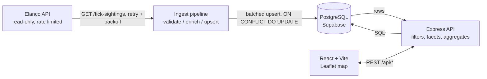

# UK Tick Sighting Tracker

**Elanco Placement Programme — Full Stack Technical Task**
**Mirzo-Ulug'bek Fazilov**

Ticks are spreading across the UK and carry diseases like Lyme disease. This is
a web application that maps crowdsourced tick sightings so pet owners and vets
can see what is happening near them, learn to identify the species involved,
and report sightings of their own.

It is a full-stack build: a Node/TypeScript API pulls the Elanco dataset into
PostgreSQL, processes it, and serves it to a React frontend.

---

## The problem that shaped the whole project

The first thing I did was check what the Elanco API actually returns. Every
record is five fields:

```json
{
  "id": "02WNholuSg6ndCk4c1dA",
  "date": "2022-08-01T06:40:31",
  "location": "Manchester",
  "species": "Marsh tick",
  "latinName": "Ixodes apronophorus"
}
```

The brief asks for map markers showing **severity**, **recent activity** and
**species**, a **severity filter**, and **aggregates per region**. Only species
is in the payload. There are no coordinates at all, no severity field, and
nothing that makes "recent" meaningful.

So three things have to be derived. Because this is full-stack, I derive them
**once on the server during ingest** and store the results, rather than
recomputing them in every browser. That decision is why the frontend ended up
purely presentational, and it is the thing I would most want to talk through in
an interview.

**1. Coordinates.** City names resolve against a table of 14 UK centroids.
Putting all 72 Manchester records on one pixel would draw a single marker and
hide that there are 72, so each sighting is offset from its centroid using a
hash of its own id. Deterministic, so a sighting lands on the same spot every
load and shared links stay valid — `Math.random()` would make markers jump
between renders. Bounded to about 6 km, the size of the city, so it never
pretends to be a street address. Both positions are stored: the offset one for
drawing, the real centroid for "Get directions".

**2. Severity.** A 0–100 score from three weighted parts: local activity
density (50%), species vector weight (30%), and seasonal questing pressure
(20%). The four levels are **percentiles of the dataset's own distribution**,
not fixed cut-offs. I tried fixed thresholds first and measured the result —
they put 0.6% of sightings in "low" and 4.4% in "severe", which makes three of
the four filter buttons useless. Percentiles, computed by Postgres with
`percentile_cont`, give a usable spread:

```
low 279 (27.9%) · moderate 279 (27.9%) · high 271 (27.1%) · severe 171 (17.1%)
```

The score and its three components are stored per row, so the API can explain a
rating instead of asking the user to trust a colour.

**3. Recency.** The dataset ends 30 December 2024. Measuring "recent" against
the real clock would mark every record stale, so the 90-day window is measured
back from the newest record in the data. The UI says exactly that wherever
recency appears.

These ratings are **modelled by this application, not supplied by Elanco**, and
the app states that wherever one appears.

---

## Features

**Map**

- Leaflet map of the UK with zoom-aware marker clustering
- Markers encode severity as both colour and size, recency as a pulsing ring,
  and community reports as a different shape
- Filters for date range, species, severity, city and recency — all applied
  server-side, with live counts showing how many results each option would give
- Click a marker for a detail panel: full record, the severity breakdown with
  reasoning, and a per-year activity timeline for the surrounding 25 km
- Quick actions: report a sighting, get directions, share (produces a
  `?sighting=<id>` link that reopens the panel)

**Analytics** — all computed in SQL, not in the browser

- Seasonal activity chart with city and year dropdowns
- Species breakdown and yearly trend
- Regional aggregates with mean severity

**Education**

- Identification guide for the five species in the dataset, with drawn
  illustrations showing the actual distinguishing features
- Prevention and safe tick-removal guidance

**Reporting**

- Form with date, time, location, species and notes
- Validation with three distinct states: errors block submission, warnings do
  not (a 3am sighting is unusual, not invalid), and success confirms
- Image upload with type and size checks, automatic downscaling, and a prompt
  for alt text
- Submitted reports are scored by the same model and become part of the
  dataset — they appear on the map, in the charts and in the filter counts

**Accessibility and design**

- Light and dark themes, keyboard-navigable map markers, live regions
  announcing filter results, table alternatives for every chart
- The severity colour ramp is single-hue and ordered by lightness. I measured
  the obvious green-to-red traffic light and rejected it: red against green is
  ΔE 4.1 under deuteranopia, effectively identical for a large share of male
  users. Lightness survives colour-vision deficiency.

---

## Tech stack

| Layer | Choice | Why |
|---|---|---|
| Frontend | React 19, TypeScript, Vite | Vite over Next.js — no server-rendering requirement for a client-side map, and no SEO need |
| Map | Leaflet + OpenStreetMap | No API key and no billing account, so anyone can clone and run it. Mapbox and Google Maps both require one |
| Charts | Recharts | Composable SVG, accessible by default. Code-split so it only loads on the Learn page |
| Backend | Node 22, TypeScript, Express 5 | Express 5 propagates async errors natively. Fastify is faster but this workload is database-bound, so the difference is noise |
| Database | PostgreSQL 17 (Supabase) | The interesting work here is aggregate SQL |
| DB driver | `pg` | Not an ORM — see below |
| Validation | Zod | Derives TypeScript types from the runtime schema, so the two cannot drift |

**Why `pg` and not Prisma or TypeORM.** The useful work is `percentile_cont`,
`date_trunc`, `FILTER (WHERE …)` and faceted counts. With an ORM I would be
writing all of that as raw SQL anyway, just through an extra layer. An ORM
would earn its place with a dozen related tables and heavy relational mapping;
there are six tables and the queries are analytical.

**Why no data-fetching library.** TanStack Query would fit, and it is a close
call now there are several endpoints and a mutation. What the app actually
needs — debounce, request cancellation, keep-previous-data — is about fifty
lines, and writing them explicitly made an out-of-order-response bug obvious
that a library would have hidden. I would add it if a third component needed
the same cached endpoint.

**Why plain-SQL migrations.** The whole schema is one file. A migration
framework adds a CLI, a config file and a DSL to run `psql -f`. My runner is
about 70 lines and still gives ordering, idempotency, per-file transactions and
a checksum that catches an already-applied migration being edited.

---

## Architecture



The flow in words:

1. **Ingest** runs on boot when the table is empty, or on demand via
   `npm run ingest`. It fetches all 1,000 records, validates each one, resolves
   the city to coordinates, scores severity, and upserts in batches.
2. **Severity levels** are then assigned from percentiles computed in SQL, and
   the breakpoints stored in `dataset_meta`.
3. **The API** serves filtered searches with facet counts, plus aggregate
   endpoints. Everything is a SQL `GROUP BY`, not an array reduce.
4. **The frontend** holds filter state and renders. It derives nothing about
   the data itself.

The Elanco API is read-only — `POST` returns `405 Method Not Allowed` — which
is exactly why the application needs its own database to accept reports.

---

## Data processing

**Fetching.** Every upstream request has a timeout and retries up to three
times with exponential backoff plus jitter. Jitter matters: without it, every
client that failed at the same moment retries at the same moment. `Retry-After`
is honoured on 429. A 4xx other than 429 is not retried, because a malformed
request will fail identically next time.

**Validation.** Each record is checked structurally before it reaches SQL. A
row missing an id, a parseable date, a location or a species is **rejected, not
coerced** — and so is one naming a city we have no coordinates for, because a
sighting that cannot be placed is not something a map can honestly show.

**Incomplete data.** Every rejection is tallied by reason into
`ingest_runs.rejection_reasons` (a `jsonb` column), so nothing is silently
dropped. On the current dataset nothing is rejected, but if the upstream data
changed, the count and the reason would be visible immediately:

```sql
SELECT status, fetched, inserted, updated, rejected, rejection_reasons
FROM ingest_runs ORDER BY started_at DESC;
```

**Duplicates.** The upstream id is the primary key and inserts use
`ON CONFLICT (id) DO UPDATE`, so ingest is idempotent. Running it twice
produces the same database and picks up any upstream corrections:

```
run 1: fetched 1000, inserted 1000, updated    0, rejected 0
run 2: fetched 1000, inserted    0, updated 1000, rejected 0
```

`RETURNING (xmax = 0)` is what distinguishes an insert from an update in the
same statement, so the run can be reported accurately rather than estimated.

**Large datasets.** Rows are written with one multi-row `INSERT` per 500-record
batch rather than a statement each — a thousand round trips costs seconds, four
batched statements costs milliseconds. The whole ingest is one transaction, so
a failure part-way leaves the previous dataset intact.

**Error handling.** A typed error taxonomy is mapped to status codes by one
middleware, so route handlers throw and never think about HTTP. Upstream
failures become 502/429, `pg` connection errors become 503, Zod failures become
400 with per-field messages the report form displays inline, and oversized
bodies become 413 with an actionable message. Stack traces, SQL and connection
strings are logged but never serialised into a response.

Verified behaviour:

```
404  unknown route, unknown sighting id
400  inverted date range, invalid severity, bad date format
400  future sighting date, invalid city/species/time (three field-level messages)
404  DELETE on an Elanco record (refused — those belong to the pipeline)
```

**Timezone handling.** The upstream `date` has no timezone designator, so
`observed_at` is `TIMESTAMP` rather than `TIMESTAMPTZ`, and the `pg` type
parser for OID 1114 is overridden to return the raw string. Letting the driver
reinterpret it would shift every British-summer sighting by an hour and
occasionally across a date boundary.

**Not implemented, would do with more time:** scheduled ingest rather than
boot-triggered, structured logging, and rate limiting on the write endpoint.

---

## API

All endpoints return JSON. Errors use a consistent
`{ "error": { "code", "message", "details"? } }` shape.

| Method | Endpoint | Description |
|---|---|---|
| `GET` | `/api/health` | Database and upstream API checked separately; only the database affects the status code |
| `GET` | `/api/meta` | Cities, species, severity breakpoints, date range, last ingest — so the frontend hard-codes nothing |
| `GET` | `/api/sightings` | Search. Filters: `from`, `to`, `city`, `species`, `severity`, `source`, `recentOnly`, `limit`, `offset`. Returns data, totals and facet counts |
| `GET` | `/api/sightings/:id` | One sighting |
| `GET` | `/api/sightings/:id/image` | Attached photograph, served separately from the JSON |
| `POST` | `/api/sightings` | Create a report. Returns 201 with the scored record |
| `DELETE` | `/api/sightings/:id` | User reports only |
| `GET` | `/api/insights/regions` | Sightings per region with mean severity |
| `GET` | `/api/insights/trends` | Time series; `?interval=week\|month\|year` |
| `GET` | `/api/insights/species` | Breakdown by species |
| `GET` | `/api/insights/seasonal` | Twelve monthly counts, including empty months |
| `GET` | `/api/insights/summary` | Headline figures in one query |
| `POST` | `/api/admin/ingest` | Trigger a re-ingest |
| `GET` | `/api/admin/ingest/status` | Last run, and whether the dataset is empty |

Every insights endpoint accepts the same filters as `/api/sightings`, so a
chart can always be scoped to exactly what the map is showing.

**Facets are worth noting.** Each filter option shows how many results it would
produce, and each dimension is counted with **its own filter excluded**. So
ticking "Severe" still shows what Low, Moderate and High would give. Counting
facets against the fully filtered set is a common bug — every unselected option
reports 0 and looks unavailable when it would actually widen the result.

---

## Database

Six tables in `public`. Full walkthrough in **[DATABASE.md](DATABASE.md)**.

| Table | Rows | Purpose |
|---|---:|---|
| `sightings` | 1000 | Fact table. Elanco records and user reports together, separated by `source`, so no query needs a `UNION` |
| `cities` | 14 | City centroids and regions — how a city name becomes a map point, and how regional aggregates group |
| `species` | 5 | Latin names, genus, vector weight for the severity model, fixed chart colour slot |
| `dataset_meta` | 1 | Severity breakpoints and date bounds, recomputed each ingest |
| `ingest_runs` | — | Audit row per run: fetched, inserted, updated, rejected, and why |
| `schema_migrations` | 2 | Applied migrations with checksums |

`sightings` has 21 columns, but only 5 come from Elanco. The rest —
coordinates, severity score, severity level and the three score components —
are computed during ingest.

Indexed on `observed_at`, `location`, `species`, `severity_level`, `source`,
plus a composite `(location, observed_at DESC)` for the commonest query shape.

**Row Level Security.** Supabase runs PostgREST over the `public` schema and
publishes it at the project URL, so any table there without RLS is readable
with the project's anon key — which is public by design and ships in browser
bundles. `002_rls.sql` enables RLS on every table and revokes the `anon` and
`authenticated` grants. With no policies defined, every row is denied to those
roles; the API is unaffected because it connects as the table owner, which is
not subject to RLS. Verified:

```
anon           -> 42501 permission denied for table sightings
authenticated  -> 42501 permission denied for table sightings
postgres       -> 1000 rows
```

---

## Project structure

```
.
├── server/                        Node + TypeScript API
│   ├── src/
│   │   ├── index.ts               Entry point, startup order, graceful shutdown
│   │   ├── app.ts                 Express assembly and middleware order
│   │   ├── config.ts              Environment parsing, validated with Zod
│   │   ├── types.ts               API contract types
│   │   ├── db/
│   │   │   ├── pool.ts            Connection pool, SSL auto-detection
│   │   │   ├── migrate.ts         Migration runner
│   │   │   ├── sightingsRepo.ts   All SQL lives here
│   │   │   ├── status.ts          npm run db:status
│   │   │   ├── reset.ts           npm run db:reset
│   │   │   └── migrations/        001_init.sql, 002_rls.sql
│   │   ├── domain/                cities, species, geo, severity model
│   │   ├── ingest/                elancoClient.ts, ingestService.ts, run.ts
│   │   ├── routes/                sightings, insights, meta
│   │   ├── middleware/            errorHandler.ts
│   │   └── lib/                   errors.ts
│   ├── .env.example
│   └── vercel.json                Express on Fluid Compute
├── web/                           React + Vite frontend
│   ├── src/
│   │   ├── components/            map/ filters/ detail/ charts/ form/ layout/ ui/
│   │   ├── hooks/                 Data provider, insights, theme
│   │   ├── lib/                   API client, display helpers, colours
│   │   ├── pages/                 Map, Learn, Report, About
│   │   ├── data/                  Species guide and prevention content
│   │   └── styles/                tokens, base, motion, components, leaflet
│   ├── .env.example
│   └── vercel.json                SPA rewrites for Vercel
└── DATABASE.md                    Schema walkthrough
```

---

## Getting started

**Requirements:** Node 20.19+ (or 22+) and a PostgreSQL 14+ database.

### 1. Database

Either a local cluster:

```bash
brew install postgresql@16
brew services start postgresql@16
createdb ticktrack
```

Or a hosted one. I used Supabase — **Dashboard → Connect → Connection string →
URI**, taking the **session pooler** (port 5432). The direct
`db.<ref>.supabase.co` host is IPv6-only on the free tier and will not resolve
on most networks, and the transaction pooler (6543) does not fully support the
extended query protocol `pg` uses for parameterised queries.

### 2. API

```bash
cd server
cp .env.example .env
```

Set `DATABASE_URL` in `server/.env`:

```bash
# local
DATABASE_URL=postgresql://localhost:5432/ticktrack

# or Supabase (percent-encode any special characters in the password)
DATABASE_URL=postgresql://postgres.<project-ref>:<password>@aws-1-<region>.pooler.supabase.com:5432/postgres
```

TLS is auto-detected from the hostname — off for localhost, on for anything
else — so the same code runs against both.

```bash
npm install
npm run dev
```

On first run this applies both migrations, fetches the 1,000 records and writes
them to the database:

```
[migrate] applied 001_init.sql
[migrate] applied 002_rls.sql
[boot] API listening on http://localhost:4000
[ingest] success in 1104ms — fetched 1000, inserted 1000, updated 0, rejected 0
[ingest] severity breakpoints: { moderate: 53, high: 60, severe: 67 }
```

### 3. Frontend

In a second terminal:

```bash
cd web
npm install
npm run dev
```

Open <http://localhost:5173>. No frontend configuration is needed locally — the
Vite dev server proxies `/api` to port 4000.

### Environment variables

`server/.env` — only `DATABASE_URL` is required:

| Variable | Default | Purpose |
|---|---|---|
| `DATABASE_URL` | — | **Required.** PostgreSQL connection string |
| `PORT` | `4000` | API port |
| `NODE_ENV` | `development` | |
| `CORS_ORIGINS` | `http://localhost:5173,http://127.0.0.1:5173` | Comma-separated allowed origins |
| `ELANCO_API_BASE_URL` | `https://dev-task.elancoapps.com/data` | Upstream API |
| `ELANCO_TIMEOUT_MS` | `20000` | Per-request timeout |
| `INGEST_ON_BOOT` | `true` | Ingest on startup when the table is empty |
| `MAX_BODY_SIZE` | `8mb` | Must clear a base64 photograph |
| `MAX_PAGE_SIZE` | `5000` | Largest page `/api/sightings` will return |
| `DATABASE_SSL` | auto | Override TLS auto-detection |

`web/.env` — all optional locally:

| Variable | Default | Purpose |
|---|---|---|
| `VITE_API_BASE_URL` | `/api` | Absolute API URL when deployed separately |
| `VITE_MAP_TILE_URL` | OpenStreetMap | Alternative tile provider |
| `VITE_MAP_TILE_ATTRIBUTION` | OpenStreetMap | Must match the provider's terms |
| `VITE_MAX_IMAGE_SIZE_MB` | `5` | Upload size limit |

No API keys are needed. The Elanco API is public and OpenStreetMap tiles
require no account.

---

## Commands

| Where | Command | What it does |
|---|---|---|
| `server/` | `npm run dev` | API with hot reload |
| | `npm run migrate` | Apply migrations only |
| | `npm run ingest` | Migrate then run the pipeline once |
| | `npm run db:status` | Tables, row counts, RLS state, migration and ingest history |
| | `npm run db:reset` | Dry run; add `-- --yes` to drop this app's tables and re-migrate |
| | `npm run build` / `npm start` | Compile to `dist/` and run |
| | `npm run typecheck` | `tsc --noEmit` |
| `web/` | `npm run dev` | Vite dev server |
| | `npm run build` | Type-check then production bundle |
| | `npm run lint` | oxlint, including React compiler rules |

From the repo root, `npm run typecheck` and `npm run build` run against both
packages.

`npm run db:reset` drops only the six tables this app creates, by name. It
never runs `DROP SCHEMA public CASCADE` — on Supabase that would destroy auth,
storage and realtime along with it.

---

## Testing and deployment

**Testing.** There is no automated test suite. I verified the application
manually and end-to-end: ingest idempotency, the severity distribution, every
API endpoint, every error path, the report submission round trip, and the RLS
lockdown. The figures quoted in this README come from those runs.

I would not call that coverage. The data layer is written as pure functions in
`server/src/domain/` specifically so it is testable, and that plus the route
handlers via supertest against a test database is where I would start. Type
checking and linting do run clean across both packages.

**Deployment.** Both halves deploy to Vercel as **two projects from the same
repository**, using Vercel's per-directory import.

| Project | Root Directory | Framework | Config |
|---|---|---|---|
| Frontend | `web` | Vite | `web/vercel.json` |
| API | `server` | Express | `server/vercel.json` |

The Express app runs as a single Vercel Function on Fluid Compute. `src/index.ts`
exports the app as a default export, which is what Vercel imports.

The frontend config adds an SPA rewrite. Without it, refreshing on `/learn` or
`/report` returns a 404, because those routes only exist client-side.

The server skips its local startup sequence when `process.env.VERCEL` is set.
That matters: migrations, the ingest-on-boot check and `app.listen()` are all
wrong for a function that cold-starts — migrations would run on the first
request after every scale-up, and ingest would re-fire a 1,000-record import
from each new instance. Migrations belong in the deploy step, so run
`npm run migrate` (or `npm run ingest` for a first population) against the
production database once, from a local machine, before the first deploy.

Required environment variables in the Vercel dashboard:

| Project | Variable | Value |
|---|---|---|
| API | `DATABASE_URL` | PostgreSQL connection string |
| API | `INGEST_ON_BOOT` | `false` |
| API | `CORS_ORIGINS` | the frontend's deployed URL |
| Frontend | `VITE_API_BASE_URL` | the API's deployed URL + `/api` |

The two must be set in that order — the frontend needs the API's URL, and the
API needs the frontend's origin for CORS, so each is deployed once and then
updated with the other's domain.

## Limitations and future improvements

- **No automated tests.** Described above. The most significant gap.
- **No authentication.** Anyone can post or delete a report. Real crowdsourcing
  needs accounts, rate limiting and moderation.
- **Images are base64 in a `TEXT` column.** Acceptable for downscaled ~100 KB
  photographs, and they are served from a separate endpoint so they never bloat
  the list payload. Production belongs in object storage with signed URLs.
- **`POST /api/admin/ingest` is unauthenticated.** It exists so the pipeline can
  be re-run during review. It needs auth, or better, replacing with a scheduled
  job — a long-running import behind an open endpoint can overload both
  services.
- **TLS chain verification is disabled** for hosted Postgres. The connection is
  encrypted but the certificate chain is not verified, because Supabase's CA is
  not in Node's trust store. The fix is to ship that CA and pass it as `ca`.
- **Marker positions are approximate by construction.** The source data is
  city-level and the UI says so.
- **The dataset's seasonality is flat.** Sightings are spread fairly evenly
  across the calendar, so the seasonal chart does not show the spring peak UK
  tick activity really has. That is a property of the supplied data, not the
  chart, and worth knowing before drawing conclusions from it.

---

## Demonstration

Walkthrough video: _to be added before submission._

---

## Notes on content

The species descriptions stay at the level the sources support — genus-level
ecology and morphology — rather than inventing species-level detail. Where a
claim would need a clinical source I do not have, the entry says so. Worth
noting that *Ixodes ricinus*, the tick most often found on UK pets and people,
does not appear in this dataset at all.

Prevention content reflects standard published UK public-health and veterinary
guidance. It is general education, and the app pairs it with a visible
statement that it is not veterinary or medical advice.

---

## Licence

MIT. Map data © OpenStreetMap contributors. Sighting data © Elanco.
